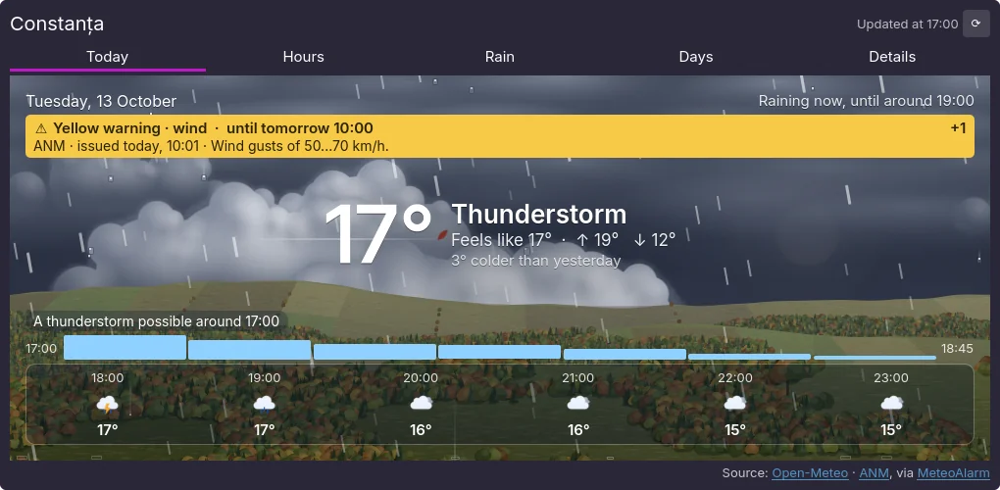
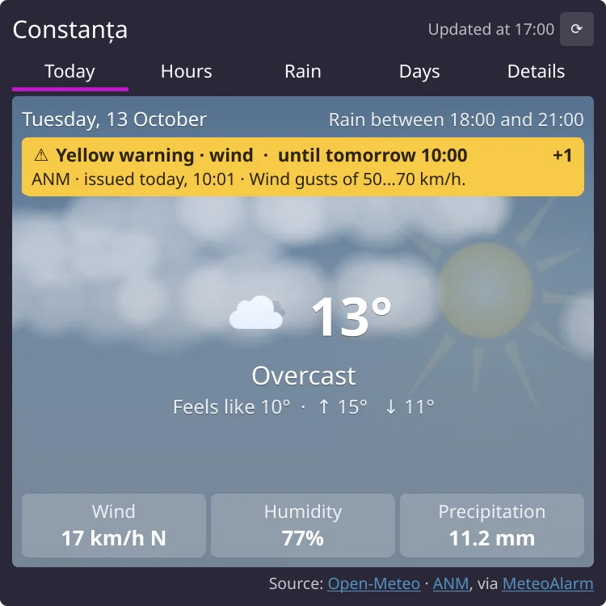

# Weather Now

A weather widget for Plasma 6 with an animated sky that follows the current weather and the hour: a blue that deepens as the sun climbs and warms at sunset, clouds with volume in three layers of depth, a sun that dims as a cloud passes and sends rays through the gaps, rain, snow, fog and thunder, and hundreds of stars at night. Around them, what the weather brings besides: a rainbow after showers, the Milky Way and shooting stars, the aurora when it can be seen from your place, wind you can see, rain running down the glass, frost, heat haze, and snow that settles. Under the sky, a landscape of your choice, as tall as you like: rolling hills with fields, woods in the colours of the season and a lone oak; a city with its street; the sea and its beach; a plain of poppies; a mountain lake that mirrors its peaks; or a village with its church, its haystacks and its well, smoke rising from the chimneys in the cold. The sky shifts a little under the mouse.



## Tabs

- **Today**: the temperature large over the animated sky, and on request the clock of the place, to the second; the warnings in force, what stands out in the hours ahead (a storm, strong gusts, frost, strong sun, fog), the rain of the next two hours when some is coming, and the next six hours on frosted glass; wind, humidity and precipitation on request
- **Hours**: the coming hours, along a curve in the colours of the temperature, with sunrise and sunset to the minute; an hour under the mouse tells how it feels, the wind and the humidity
- **Rain**: when and how hard it will rain, over 48 hours or the next 2 hours; the bar under the mouse gives its amount and chance. Or the radar: the rain of the last two hours around your place, image after image, over the relief of the land with its borders and towns; closer or farther with the wheel
- **Days**: 16 days ahead, grouped by week, starting with the first day of the week you choose, each with a bar from its low to its high; a click on a day opens its hours
- **Details**: a compass for the wind (with its Beaufort force), dials for pressure (with what its change foretells), UV (with when to protect your skin), air quality, dew point and the Kp index (with the chance of seeing the aurora tonight), a view of how far you see, the ways of the sun and of the moon (with moonrise and moonset), the pollen of the next days, a forecast for running, cycling, hiking, gardening or stargazing, humidity and cloud cover. Drag the tiles into the order you want, close the ones you do not need with their ×, and the others grow to fill the room, in full rows

Everything lights up under the mouse, and the instruments play again.



## Also

- In English, German, Spanish, French, Italian, Polish or Romanian; follows the Plasma language by default
- Inter as its font, included, or any other one; first day of the week, units (°C or °F; km/h, m/s, mph or knots as kn or kt; mm or inches), font, text size, background (black, the Plasma theme's or transparent, as much as you like), what is behind the text of Today (the animated sky, only the glass boxes, or only the text, in the colours of the Plasma theme), icons (Meteocons or the Plasma theme's), animation level and visible tabs are configurable
- Asks for your place on first start; search any place in the world, as you would write it: a letter off, without its diacritics, or with its county after it
- Official weather warnings with the full text, the service that issued them and the time of issue: in Romania through MeteoAlarm, elsewhere through KDE's public alert server (alerts.kde.org)
- Desktop notifications, each to turn on: a new warning, rain or snow about to start, frost tonight
- Several places, to switch between from the title, with the mouse wheel or with Ctrl+← →
- Small on the desktop, it shows less: the temperature and a line, a band of the next hours, or today and three days
- A summary of the day in the morning, as a notification at the time you choose
- In a panel: the weather, the temperature and, when rain is coming within 12 hours, when it starts; its tooltip shows the next hours and days
- Keyboard: Ctrl+Tab between the tabs, Enter on a day, Ctrl and the arrows to move a tile, Delete to close it; screen readers get a name for everything
- Times in 24 or 12 hours, as your regional settings write them
- Stands still when the Plasma animation speed is set to "Instant", and on the desktop while a window fills the screen
- An animated wallpaper too, with the same sky and landscapes; it stands still while a window fills the screen. On the lock screen, which may not fetch anything, it shows the sky of the hour, without the weather

Immediate warnings (nowcasting) are prepared in the code but switched off: their source requires a written consent, which has not come yet. Until it does, the widget asks nothing of that source and the option cannot be turned on.

## Install

From a release, with the `.plasmoid` file from the [releases page](https://github.com/oriceon/weather-now/releases):

```bash
kpackagetool6 --type Plasma/Applet --install weather-now-2.2.0.plasmoid
```

From this repository:

```bash
./install.sh --restart
```

`install.sh` installs or upgrades the widget from `package/`; `--restart` restarts Plasma, which otherwise keeps the old code in memory.

The wallpaper is a package of its own, in `wallpaper/`, which shares the sky and the landscapes of the widget:

```bash
./wallpaper/install.sh
```

Then right-click the desktop, *Configure Desktop and Wallpaper*, and pick *Weather Now* as the wallpaper type.

Requires Plasma 6.1 or later (tested on Plasma 6.7).

## Privacy

The widget asks Open-Meteo for the forecast of your place and for its air quality, the latter rounded to about a kilometre, and for the warnings the MeteoAlarm feed in Romania or KDE's public alert server elsewhere, about an area of some 10 km around it. The place search sends what you type to the Open-Meteo geocoding service. The Kp index comes from NOAA, the same file for everyone, without anything about you. Only once you open the radar, its images come from RainViewer and its map from NASA GIBS, as tiles around your place. The wallpaper asks Open-Meteo for the weather now of the place chosen in its settings, every quarter of an hour. No key or account is needed, and nothing is sent anywhere else.

It asks as little as it can: answers are kept for a few minutes, so that switching between places, units or languages, or another widget or screen with the same place, asks nothing again; a place passed over with the wheel is not asked for at all; after a failure it waits longer each time, and an hour when a service says it is asked too often; the radar keeps within RainViewer's limit of requests a minute, for all the radars on the desktop together.

## Development

The widget is plain QML, with no build step. What it computes lives in `package/contents/code/*.mjs`, modules without Qt, tested with Node:

```bash
node --test tests/*.test.mjs
```

`tests/qml/viewer.py` loads the QML in a real Qt engine (PySide6), with stand-ins for the Plasma and Kirigami modules, and saves a screenshot. It exits with 1 on any QML error or warning.

```bash
pip install PySide6-Essentials
export QT_QPA_PLATFORM=offscreen QT_QUICK_BACKEND=software
cd tests/qml
python viewer.py stage out.png --tab 3 --alerts          # a tab, from recorded answers
python viewer.py applet out.png --wait 6000              # the whole widget, with the real services
python viewer.py applet out.png --forbid-host meteoromania.ro  # fails if that site is asked for anything
python viewer.py config out.png --page 1                 # a page of the settings
python viewer.py wallpaper out.png --size 1280x720       # the wallpaper (run wallpaper/sync.sh first)
```

The landscapes are drawn in `package/contents/code/land/`, a module for each, in layers that the viewer can check at the size of a widget and of a wide screen.

`tools/fonts/subset.py` makes `package/contents/fonts` from the static fonts of an Inter release, cut down to the Latin scripts; it needs fontTools (`pip install fonttools`). `tools/build-icons.mjs` builds `package/contents/icons` from the Meteocons packages: the animations are drawn frame by frame with Skia into film strips the widget plays. `tools/store/animations.sh` remakes the animations of this page from the viewer; it needs Pillow (`pip install pillow`).

## Credits and licence

- Forecast: [Open-Meteo](https://open-meteo.com), CC BY 4.0
- Icons: [Meteocons](https://meteocons.com) by Bas Milius, MIT (see `package/contents/icons/LICENSE`)
- Font: [Inter](https://rsms.me/inter/) by Rasmus Andersson and the Inter Project Authors, SIL Open Font License 1.1 (see `package/contents/fonts/Inter-LICENSE.txt`); cut down to the Latin scripts and named *Weather Now Inter*, so that it does not stand in for an Inter installed on the system
- Places: [GeoNames](https://www.geonames.org/), CC BY 4.0, through the Open-Meteo geocoding API
- Warnings: Administrația Națională de Meteorologie (ANM), via EUMETNET – [MeteoAlarm](https://www.meteoalarm.org), CC BY 4.0; elsewhere the official service named with each warning, via the [FOSS Public Alert Server](https://alerts.kde.org) of KDE
- Air quality and pollen: CAMS European air quality forecasts, [Copernicus Atmosphere Monitoring Service](https://atmosphere.copernicus.eu/), via Open-Meteo
- Kp index: [NOAA Space Weather Prediction Center](https://www.swpc.noaa.gov/), public domain
- Radar: [RainViewer](https://www.rainviewer.com/), free for personal and educational use; map: [NASA Global Imagery Browse Services (GIBS)](https://earthdata.nasa.gov/gibs), part of NASA's Earth Science Data and Information System (ESDIS), with borders and names from [OpenStreetMap](https://www.openstreetmap.org/copyright) contributors

Time delays between this website and the www.meteoalarm.org website are possible. For the most up-to-date awareness information as published by the participating National Meteorological and Hydrological Services, please refer to www.meteoalarm.org.

Weather Now is free software, under the GNU General Public License, version 2 or later. See [LICENSE](LICENSE).
