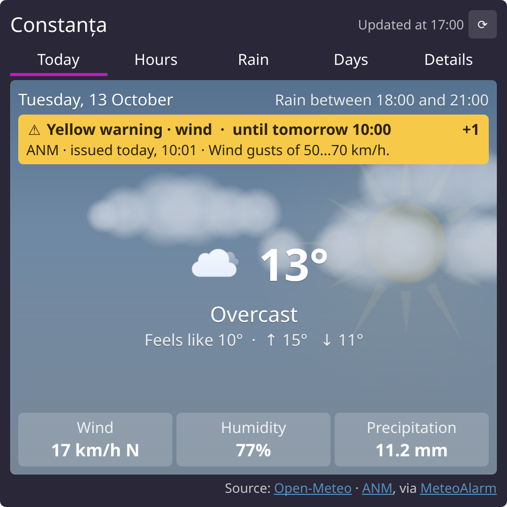
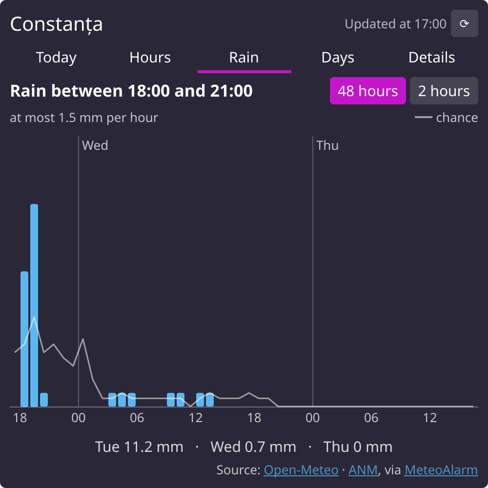
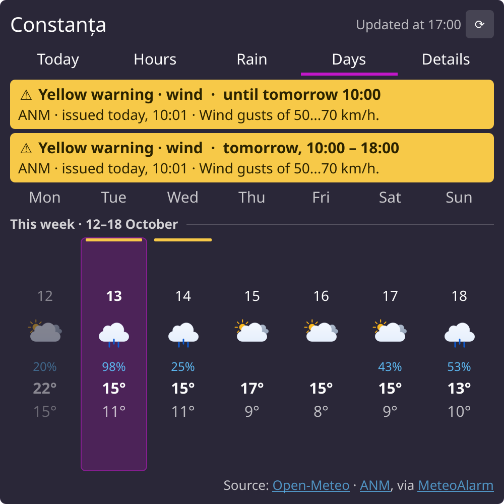

# Weather Now

A weather widget for Plasma 6 with an animated sky that follows the current weather: rain, snow, fog, thunder, drifting clouds, the sun and the moon.

| Today | Rain | Days |
|---|---|---|
|  |  |  |

## Tabs

- **Today**: the weather now, under the animated sky, with the warnings in force
- **Hours**: the coming hours
- **Rain**: when and how hard it will rain, over 48 hours or the next 2 hours
- **Days**: 16 days ahead, grouped by week, starting with the first day of the week you choose
- **Details**: wind and gusts, humidity, pressure, cloud cover, UV, sunrise and sunset, moon phase

## Also

- English or Romanian interface; follows the Plasma language by default
- First day of the week, units, font, text size, icons (Meteocons or the Plasma theme's), animation level and visible tabs are configurable
- Asks for your place on first start; search any place in the world
- Official weather warnings for Romania: the county warnings of ANM, with the full warning text, the issuing service and the time of issue

The immediate warnings of ANM (nowcasting) are prepared in the code but switched off: the terms of meteoromania.ro require the written consent of ANM, which has not come yet. Until it does, the widget asks nothing of that site and the option cannot be turned on.

## Install

From a release, with the `.plasmoid` file from the [releases page](https://github.com/oriceon/weather-now/releases):

```bash
kpackagetool6 --type Plasma/Applet --install weather-now-1.0.0.plasmoid
```

From this repository:

```bash
./install.sh --restart
```

`install.sh` installs or upgrades the widget from `package/`; `--restart` restarts Plasma, which otherwise keeps the old code in memory.

Requires Plasma 6 (tested on Plasma 6.7).

## Privacy

The widget asks Open-Meteo for the forecast of your place and, for Romania, the MeteoAlarm feed for the warnings. The place search sends what you type to the Open-Meteo geocoding service. No key or account is needed, and nothing is sent anywhere else.

## Development

The widget is plain QML, with no build step. What it computes lives in `package/contents/code/*.mjs`, modules without Qt, tested with Node:

```bash
node --test tests/*.test.mjs
```

`tests/qml/viewer.py` loads the QML in a real Qt engine (PySide6), with stand-ins for the Plasma and Kirigami modules, and saves a screenshot. It exits with 1 on any QML error or warning.

```bash
pip install PySide6-Essentials
export QT_QPA_PLATFORM=offscreen QT_QUICK_BACKEND=software
cd tests/qml
python viewer.py stage out.png --tab 3 --alerts          # a tab, from recorded answers
python viewer.py applet out.png --wait 6000              # the whole widget, with the real services
python viewer.py applet out.png --forbid-host meteoromania.ro  # fails if that site is asked for anything
python viewer.py config out.png --page 1                 # a page of the settings
```

`tools/build-icons.mjs` builds `package/contents/icons` from the Meteocons packages: the animations are drawn frame by frame with Skia into film strips the widget plays.

## Credits and licence

- Forecast: [Open-Meteo](https://open-meteo.com), CC BY 4.0
- Icons: [Meteocons](https://meteocons.com) by Bas Milius, MIT (see `package/contents/icons/LICENSE`)
- Warnings: Administrația Națională de Meteorologie (ANM), via EUMETNET – [MeteoAlarm](https://www.meteoalarm.org), CC BY 4.0

Time delays between this website and the www.meteoalarm.org website are possible. For the most up-to-date awareness information as published by the participating National Meteorological and Hydrological Services, please refer to www.meteoalarm.org.

Weather Now is free software, under the GNU General Public License, version 2 or later. See [LICENSE](LICENSE).
